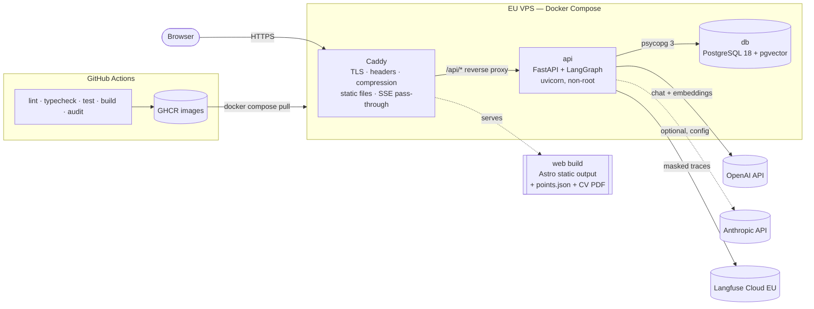
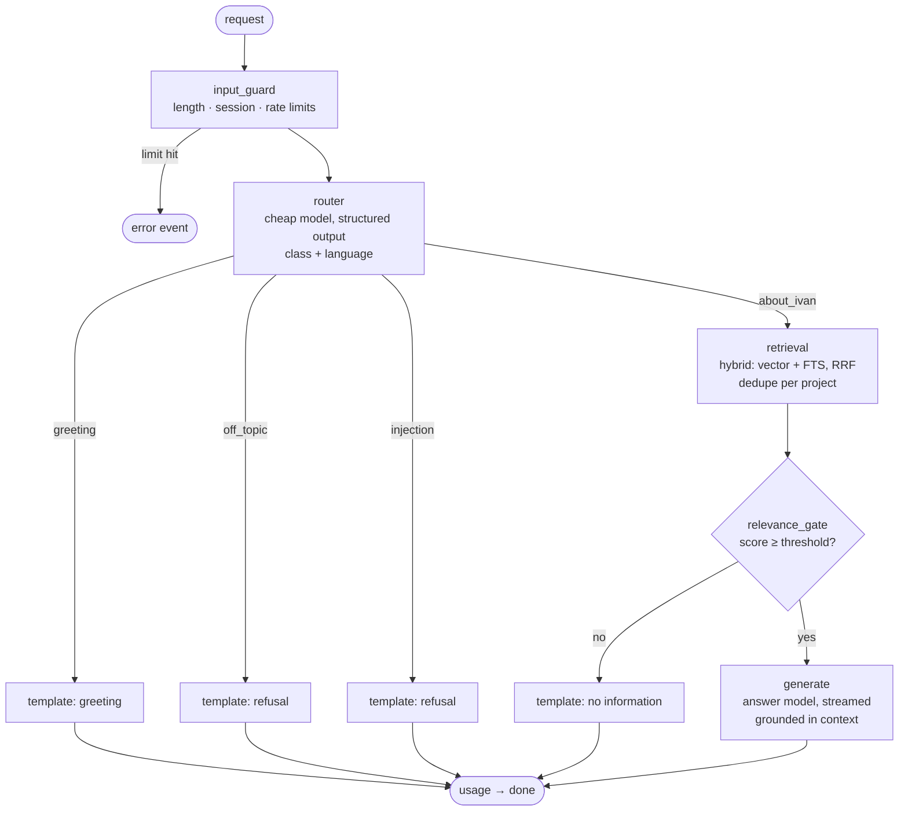
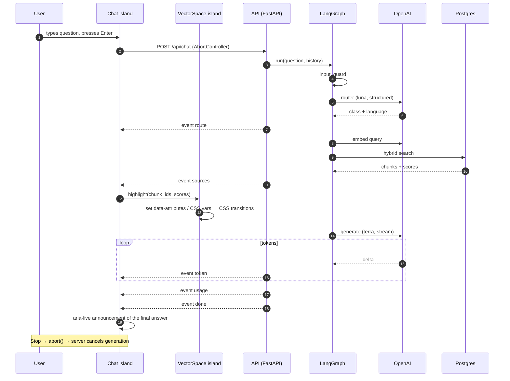

# Architecture

- **Status:** Draft
- **Last updated:** 2026-11-01

Product requirements: [SPEC](../SPEC.md). Decisions: [ADRs](adr/).

## 1. Components and deployment



- **`web`:** the Astro build is fully static. Caddy serves it from a volume or from its own image layer.
- **`api`:** the only dynamic service. It is stateless except for the in-memory rate limiter, so there is a single instance.
- **`db`:** reachable only on the internal Compose network. There are no published ports.
- **Ingestion** is a CLI command of the `api` image (`python -m site_api.ingestion`), run manually or in CI. It is not a long-running service.

## 2. Repository layout

```
/
├─ CLAUDE.md · SPEC.md · README.md · LICENSE · .mcp.json
├─ .claude/            settings.json, rules/, agents/, skills/, hooks/, output-styles/
├─ apps/
│  ├─ web/             Astro + React islands (Claude zone)
│  │  └─ src/
│  │     ├─ pages/          index.astro (AI mode), cv.astro, privacy.astro
│  │     ├─ content/cv/     CV source (Markdown + frontmatter)
│  │     ├─ components/     Astro and React components, one folder each
│  │     ├─ islands/        Chat/, VectorSpace/
│  │     ├─ lib/            sse/, api/ (generated types), viz/
│  │     └─ styles/         tokens, layers, mixins
│  └─ api/             FastAPI + LangGraph (see §3)
├─ data/               experience-notes.md, about-me-personal.md
│  └─ raw/             CV in Word — git-ignored
├─ infra/              docker-compose.yml, Caddyfile, scripts
└─ docs/               ARCHITECTURE, ROADMAP, TESTING, RUNBOOK, CREDITS, adr/
```

## 3. Backend package layout and work zones

`apps/api/src/site_api/`:

| Folder | Purpose | Zone |
|---|---|---|
| `core/` | Settings (pydantic-settings), logging, error format, model price table | Claude |
| `routers/` | HTTP endpoints: `health`, `chat` (SSE glue only) | Claude |
| `schemas/` | Pydantic request / response models and the SSE `ChatEvent` union: the API contract | Claude |
| `services/` | Rate limits, session limits, chat statistics, masking | Claude |
| `db/` + `migrations/` | SQLAlchemy models, session, Alembic migrations | Claude (Ivan reviews the vector table design) |
| **`ingestion/`** | Loaders, chunking, embeddings, 2D projection, `points.json` export, content hashing | **Mentor (Ivan writes)** |
| **`rag/`** | Hybrid retrieval, fusion, relevance gate, per-project deduplication | **Mentor** |
| **`graph/`** | LangGraph state, nodes, graph assembly, per-node timing and tokens | **Mentor** |
| **`prompts/`** | Versioned prompt files (system prompt, router prompt, templates per language) | **Mentor** |
| **`evals/`** | Eval datasets and metrics (pytest + DeepEval) | **Mentor** |

Mentor-zone folders are listed in `apps/api/CLAUDE.md` and in the `paths:` frontmatter of `.claude/rules/mentor-mode.md` ([ADR-0007](adr/0007-mentor-mode.md)).

The boundary between zones is the contract:
- `routers/chat.py` calls `graph.run(...)`, which yields typed `ChatEvent`s;
- the router serializes them to SSE.

## 4. LangGraph graph



- **State:** a typed `TypedDict` / Pydantic model holding:
  - question, language, history;
  - route;
  - retrieved chunks with scores;
  - per-node timings and token usage.
- **Nodes:** each node is a small function. Each node records `ms` and its token usage, which feed the `usage` event.
- **Templates:** these nodes never call the answer model.
- The Mermaid diagram is regenerated from the compiled graph (`graph.get_graph().draw_mermaid()`) and kept in sync with this section.

## 5. Ingestion data flow (including 2D projection)

```mermaid
flowchart LR
  subgraph sources[Sources]
    cv[CV content collection<br/>apps/web/src/content/cv]
    exp[data/experience-notes.md]
    per[data/about-me-personal.md]
    docs[SPEC · ARCHITECTURE · ADRs]
    gh[GitHub READMEs<br/>allow-list]
  end
  sources --> load[load + normalize<br/>metadata: source_type, section,<br/>category, date, url, project]
  load --> chunk[chunk<br/>heading-aware split]
  chunk --> hash{content_hash<br/>changed?}
  hash -->|unchanged| keep[keep existing row,<br/>embedding and x/y]
  hash -->|new / changed| embed[embed<br/>text-embedding-3-large @1536]
  embed --> upsert[(upsert into<br/>chunks table)]
  hash -->|removed| delete[(delete row)]
  upsert --> project[2D projection<br/>UMAP, fixed random_state<br/>stability policy: ADR-0006]
  keep --> project
  project --> store[(store x, y<br/>normalized 0..1)]
  store --> export[[export points.json<br/>id · x · y · source_type · section]]
  export --> web[apps/web/public/data/points.json]
```



- **Idempotent:** re-running without changes makes zero embedding calls and no row changes.
- **Chunk IDs** are stable and human-readable: `<source>:<slug>:<n>`.
- **How `points.json` reaches the site (proposed, SPEC Q3):**
  - **Sources in the image:** the `api` image is built with the repo root as its build context and copies the ingestion sources: `data/*.md` (not `data/raw/`), `SPEC.md`, `docs/ARCHITECTURE.md`, `docs/adr/` and `apps/web/src/content/cv/`.
  - **In production:** ingestion runs on the VPS (`docker compose run --rm api python -m site_api.ingestion`) and writes `points.json` to a named volume `points`. Caddy mounts that volume read-only and serves it at `/data/points.json` with a short cache.
  - **In development:** ingestion writes to `apps/web/public/data/points.json` (git-ignored).
  - **Effect:** the web build does not depend on the DB, and the visualization fetches the file at runtime.
- **The phone number is never present:** the Word CV is not an ingestion source, and a test asserts that no phone-number pattern appears in any chunk.

## 6. Chat request flow (SSE + point highlight)



- **Island communication:** the chat island dispatches a DOM `CustomEvent` (`vector-space:highlight`) and the visualization island listens to it. There is no shared global store.
- **Highlight:** the visualization changes only classes and CSS custom properties. Motion comes from CSS transitions on `opacity` and `transform` ([ADR-0005](adr/0005-visualization-rendering.md)).

## 7. Cross-cutting

- **Config:**
  - Python: `core/config.py` (pydantic-settings, env only);
  - model IDs, prices, temperatures, token limits, relevance threshold and rate limits are all config;
  - frontend: build-time env for the API base URL only.
- **Contract:** the FastAPI OpenAPI schema → `openapi-typescript` → `apps/web/src/lib/api/schema.d.ts`. A CI check fails if the generated file is stale.
- **Observability:**
  - structured JSON logs without question texts;
  - Langfuse traces with masked inputs;
  - chat statistics table in Postgres.
- **Prompt caching:** the static system prompt goes first, then retrieved context, then history and the question. With Anthropic, an explicit `cache_control` breakpoint goes after the static prefix.
