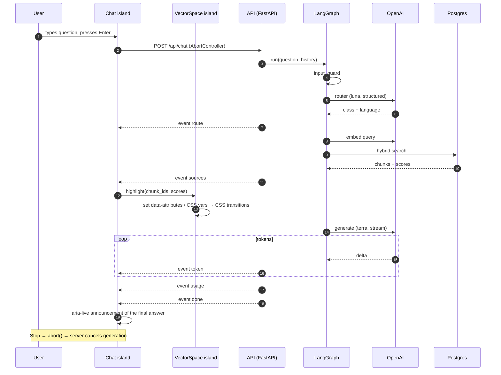

# Architecture

- **Status:** Draft
- **Last updated:** 2026-11-01

Product requirements: [SPEC](../SPEC.md). Decisions: [ADRs](adr/).

## 1. Components and deployment


- **`web`:** the Astro build is fully static. Caddy serves it from a volume or from its own image layer.
- **`api`:** the only dynamic service. It is stateless except for the in-memory rate limiter, so there is a single instance.
- **`db`:** reachable only on the internal Compose network. There are no published ports.
- **Ingestion** is a CLI command of the `api` image (`python -m site_api.ingestion`), run manually or in CI. It is not a long-running service.

## 2. Repository layout

```
/
├─ CLAUDE.md · SPEC.md · README.md · LICENSE · .mcp.json
├─ .claude/            settings.json, rules/, agents/, skills/, hooks/, output-styles/
├─ apps/
│  ├─ web/             Astro + React islands (Claude zone)
│  │  └─ src/
│  │     ├─ pages/          index.astro (AI mode), cv.astro, privacy.astro
│  │     ├─ content/cv/     CV source (Markdown + frontmatter)
│  │     ├─ components/     Astro and React components, one folder each
│  │     ├─ islands/        Chat/, VectorSpace/
│  │     ├─ lib/            sse/, api/ (generated types), viz/
│  │     └─ styles/         tokens, layers, mixins
│  └─ api/             FastAPI + LangGraph (see §3)
├─ data/               experience-notes.md, about-me-personal.md
│  └─ raw/             CV in Word — git-ignored
├─ infra/              docker-compose.yml, Caddyfile, scripts
└─ docs/               ARCHITECTURE, ROADMAP, TESTING, RUNBOOK, CREDITS, adr/
```

## 3. Backend package layout and work zones

`apps/api/src/site_api/`:

| Folder | Purpose | Zone |
|---|---|---|
| `core/` | Settings (pydantic-settings), logging, error format, model price table | Claude |
| `routers/` | HTTP endpoints: `health`, `chat` (SSE glue only) | Claude |
| `schemas/` | Pydantic request / response models and the SSE `ChatEvent` union: the API contract | Claude |
| `services/` | Rate limits, session limits, chat statistics, masking | Claude |
| `db/` + `migrations/` | SQLAlchemy models, session, Alembic migrations | Claude (Ivan reviews the vector table design) |
| **`ingestion/`** | Loaders, chunking, embeddings, 2D projection, `points.json` export, content hashing | **Mentor (Ivan writes)** |
| **`rag/`** | Hybrid retrieval, fusion, relevance gate, per-project deduplication | **Mentor** |
| **`graph/`** | LangGraph state, nodes, graph assembly, per-node timing and tokens | **Mentor** |
| **`prompts/`** | Versioned prompt files (system prompt, router prompt, templates per language) | **Mentor** |
| **`evals/`** | Eval datasets and metrics (pytest + DeepEval) | **Mentor** |

Mentor-zone folders are listed in `apps/api/CLAUDE.md` and in the `paths:` frontmatter of `.claude/rules/mentor-mode.md` ([ADR-0007](adr/0007-mentor-mode.md)).

The boundary between zones is the contract:
- `routers/chat.py` calls `graph.run(...)`, which yields typed `ChatEvent`s;
- the router serializes them to SSE.

## 4. LangGraph graph


- **State:** a typed `TypedDict` / Pydantic model holding:
  - question, language, history;
  - route;
  - retrieved chunks with scores;
  - per-node timings and token usage.
- **Nodes:** each node is a small function. Each node records `ms` and its token usage, which feed the `usage` event.
- **Templates:** these nodes never call the answer model.
- The Mermaid diagram is regenerated from the compiled graph (`graph.get_graph().draw_mermaid()`) and kept in sync with this section.

## 5. Ingestion data flow (including 2D projection)

```mermaid
flowchart LR
  subgraph sources[Sources]
    cv[CV content collection<br/>apps/web/src/content/cv]
    exp[data/experience-notes.md]
    per[data/about-me-personal.md]
    docs[SPEC · ARCHITECTURE · ADRs]
    gh[GitHub READMEs<br/>allow-list]
  end
  sources --> load[load + normalize<br/>metadata: source_type, section,<br/>category, date, url, project]
  load --> chunk[chunk<br/>heading-aware split]
  chunk --> hash{content_hash<br/>changed?}
  hash -->|unchanged| keep[keep existing row,<br/>embedding and x/y]
  hash -->|new / changed| embed[embed<br/>text-embedding-3-large @1536]
  embed --> upsert[(upsert into<br/>chunks table)]
  hash -->|removed| delete[(delete row)]
  upsert --> project[2D projection<br/>UMAP, fixed random_state<br/>stability policy: ADR-0006]
  keep --> project
  project --> store[(store x, y<br/>normalized 0..1)]
  store --> export[[export points.json<br/>id · x · y · source_type · section]]
  export --> web[apps/web/public/data/points.json]
```



- **Loading (ROADMAP 3.2, `ingestion/sources.py`):** one LangChain `Document` per source file with the metadata `doc_id` (`<source>:<slug>`), `source_type`, `category`, `title`, `url`, `source_date` and `project`. Frontmatter is validated with Pydantic models that forbid unknown keys. CV entries are rendered from their frontmatter into Markdown, preceded by the note "written by Ivan in the first person" (Elio retells it in the third person).
- **GitHub READMEs (ROADMAP 3.5, `ingestion/github.py`):** only the repositories in the `github_readmes` allow-list (config; every one must belong to `github_owner`), fetched without a token, so only public repositories are served. Images and HTML tags are removed, phone-like strings are redacted (`ingestion/pii.py`), and a short note from the allow-list (what the repository is) is repeated in every chunk. `project` is the CV project slug, so README and CV chunks of one project deduplicate together. A failed fetch stops the run instead of deleting that README's chunks. Default allow-list: NumbersValidator (the Little Lemon repository still has the Create React App boilerplate README). New sources: the `add-rag-source` skill.
- **Chunking strategy (ROADMAP 3.3, `ingestion/chunking.py`):**
  1. split at `#` / `##` / `###` headings (`MarkdownHeaderTextSplitter`, which ignores `#` inside code blocks), so a chunk never mixes two jobs, two personal questions or two parts of an ADR;
  2. split a section longer than `chunk_size` (1200 characters, config) into pieces with `RecursiveCharacterTextSplitter` (overlap 150 characters, config), at line and word boundaries;
  3. start every chunk with a breadcrumb `Title > Section > Subsection`: the splitter cuts the headings out, and the breadcrumb gives the embedding, the full-text search and the answer model the context back (which job a "Key stories" piece belongs to, which question a personal answer answers);
  4. text before the first heading is the document's context note (the CV's first-person note); it is repeated in every chunk of that document;
  5. `section` (the map label and the `sources.section` field) is the innermost heading, or the title when there is none.

  On 2026-11-04 the repository gives ~220 chunks, ~140k characters (~35k tokens).
- **Chunk IDs** are human-readable: `<doc_id>:<n>` = `<source>:<slug>:<n>` (`cv:brainrocket:0`), numbered in document order. Inserting text early in a document shifts the numbers after it, but that costs nothing: embeddings and coordinates are matched by content hash, not by id.
- **Idempotent (ROADMAP 3.4, `ingestion/sync.py`):** each chunk's `content_hash` is the SHA-256 of its text. A run compares the planned rows with the stored ones: identical rows are left alone, a changed row reuses any stored embedding with the same hash, and only texts with an unknown hash are embedded. A re-run without changes makes zero embedding calls and changes zero rows. Rows whose ids disappeared are deleted. `x` / `y` survive an update with the same hash and are reset otherwise (placed again by the projection, ROADMAP 6.1).
- **Paid calls only on purpose:** `python -m site_api.ingestion --estimate` prints the plan and the embedding cost and calls nothing; `--apply` embeds and writes (CLAUDE.md golden rule 13).
- **How `points.json` reaches the site (proposed, SPEC Q3):**
  - **Sources in the image:** the `api` image is built with the repo root as its build context and copies the ingestion sources: `data/*.md` (not `data/raw/`), `SPEC.md`, `docs/ARCHITECTURE.md`, `docs/adr/` and `apps/web/src/content/cv/`.
  - **In production:** ingestion runs on the VPS (`docker compose run --rm api python -m site_api.ingestion --apply`) and writes `points.json` to a named volume `points`. Caddy mounts that volume read-only and serves it at `/data/points.json` with a short cache.
  - **In development:** ingestion writes to `apps/web/public/data/points.json` (git-ignored).
  - **Effect:** the web build does not depend on the DB, and the visualization fetches the file at runtime.
- **Retrieval (ROADMAP 3.6, `rag/`):** the question is embedded with the ingestion model; a vector search (cosine, HNSW) and a full-text search (any of the question's words, `ts_rank`, GIN) each return `retrieval_candidates` chunks; Reciprocal Rank Fusion merges the two rankings into a 0..1 score; at most `retrieval_max_per_project` chunks of one project survive, and the best `retrieval_top_k` go on. Hand-written SQL, not `PGVectorStore` ([ADR-0003](adr/0003-vector-database.md) amendment).
- **The phone number is never present:** the Word CV is not an ingestion source, and a test asserts that no phone-number pattern appears in any chunk.

## 6. Chat request flow (SSE + point highlight)



- **Island communication:** the chat island dispatches a DOM `CustomEvent` (`vector-space:highlight`) and the visualization island listens to it. There is no shared global store.
- **Highlight:** the visualization changes only classes and CSS custom properties. Motion comes from CSS transitions on `opacity` and `transform` ([ADR-0005](adr/0005-visualization-rendering.md)).

## 7. Cross-cutting

- **Config:**
  - Python: `core/config.py` (pydantic-settings, env only);
  - model IDs, prices, temperatures, token limits, relevance threshold and rate limits are all config;
  - frontend: build-time env for the API base URL only.
- **Contract:** the FastAPI OpenAPI schema → `openapi-typescript` → `apps/web/src/lib/api/schema.d.ts`. A CI check fails if the generated file is stale.
- **Observability:**
  - structured JSON logs without question texts;
  - Langfuse traces with masked inputs;
  - chat statistics table in Postgres.
- **Prompt caching:** the static system prompt goes first, then retrieved context, then history and the question. With Anthropic, an explicit `cache_control` breakpoint goes after the static prefix.
